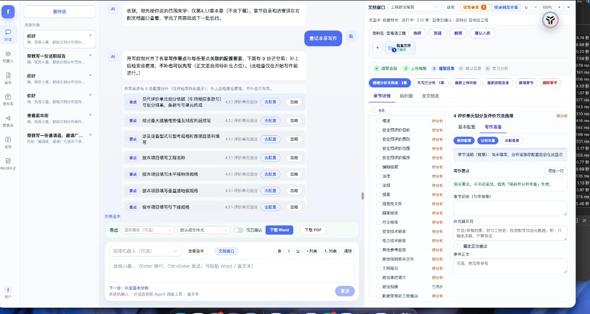
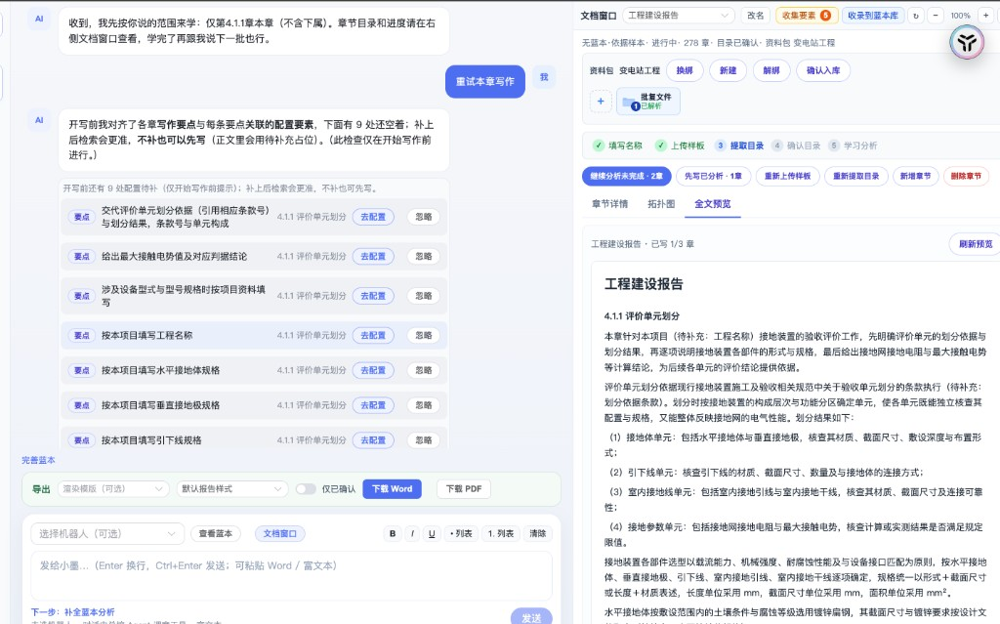
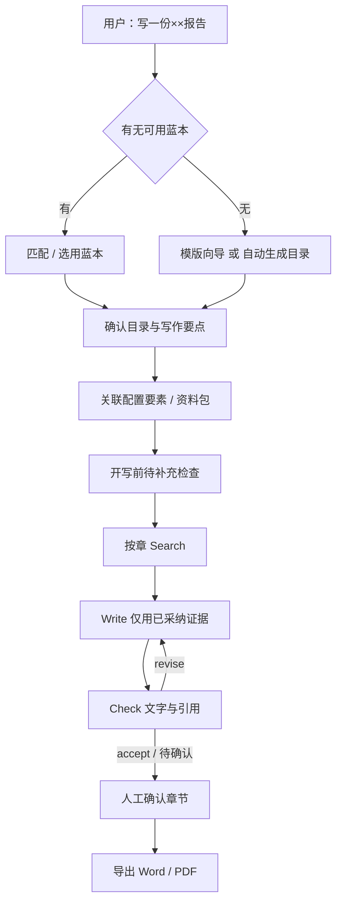

# 报告书写（report-write）

对话驱动的智能报告写作系统：用蓝本（样板）学习写法，按章节检索资料、生成正文、检查引用，并支持人工确认后导出 Word / PDF。

面向述职报告、可研报告、考核材料等「有固定章节结构、需要引用项目资料」的长文档。对话总控（小墨）负责理解意图、补齐槽位、调用工具；学习 / 检索 / 写作 / 检查四个专员各管一段，不把整篇报告一次塞给模型。

### 界面预览

左侧对话、右侧文档窗：改目录 / 要点 / 要素，与口语操作等价。



全文预览与写作进度可在同一文档窗切换查看。



---

## 主要功能

| 能力 | 说明 |
|------|------|
| 对话写文档 | 自然语言开写、选蓝本、分析章节、逐章或批量写作；界面点选与口语等价 |
| 蓝本库 | 上传 Word / PDF 样板，解析目录与写法，确认后可复用 |
| 无蓝本路径 | 按用户描述自动生成章节目录，或从样本文件抽大纲 |
| 要素与要点 | 章节写作要点可关联配置要素（键值、文件、资料槽、LLM、图片等）；开写前检查未关联项 |
| 资料包 / 资料库 | 按槽位挂项目文件，检索时只使用当前任务相关资料 |
| 个人要素库 | 确认后的要素可收入个人库，跨任务复用 |
| 书写机器人 | 可配置写作风格、导出规则，按文档类型选用 |
| 排版模版 / Word 样式 | 渲染 HTML → Word / PDF 时套用版式 |
| 人工确认 | 章节草稿需确认后才成为正式正文；可改写、退回重写、跳过 |
| 导出 | 已确认章节导出 Word；PDF 需本机安装 WeasyPrint 依赖（见下文） |

---

## 技术架构

```
浏览器（Vue 3 + Element Plus）
        │  HTTP / SSE
        ▼
FastAPI（report_writing.api）
        │
        ├── chat/          会话编排、意图、卡片、开写闸门
        ├── controller/    学习 / 大纲 / 写作流程
        ├── agents/        总控 + Study / Search / Write / Check
        ├── domain/        任务、大纲、要素、要点模型
        ├── services/      任务存储、流水线、渲染、目录同步
        └── infra/         百炼 LLM、RAG 解析、嵌入、配置
                │
                ├── MySQL（蓝本 / 机器人 / 任务目录 / 会话刷库）
                ├── Redis（会话热状态）
                ├── 本地 data/（用户工作区、上传文件、task.json）
                └── 外部 RAG / 文件服务（可选）
```

### 运行时分层

| 层 | 路径 | 职责 |
|----|------|------|
| 前端 | `frontend/` | 对话页、文档窗、蓝本 / 要素 / 资料库、机器人与排版 |
| HTTP API | `backend/src/report_writing/api/` | FastAPI 路由；静态资源来自 `npm run build` |
| 对话编排 | `backend/src/report_writing/chat/` | 意图识别、澄清、工具调用、SSE 进度、开写前要点检查 |
| 总控与专员 | `backend/src/report_writing/agents/` | LangChain `create_agent` 工具循环；无密钥时可用脚本模型离线走通 |
| 领域模型 | `backend/src/report_writing/domain/` | `WritingTask`、大纲、`point_items`、要素节点 |
| 存储 | `services/store.py` + `data/` | 任务 JSON 为写作真源；MySQL 存目录级对象 |
| 渲染 | `services/render.py`、`html_docx.py`、`html_pdf.py` | 确认正文 → Word / PDF |

### 核心技术栈

- **后端**：Python 3.11+、FastAPI、Pydantic v2、LangChain / LangGraph
- **前端**：Vue 3、Vite 7、Element Plus、Vue Flow（要素拓扑）
- **模型**：阿里云百炼 OpenAI 兼容接口（主模型 / 总控模型 / 意图模型可分开配）
- **数据**：MySQL 8、Redis；`REPORT_WRITING_DATABASE=file` 时可纯文件运行
- **解析**：默认走 RAG `parse-full-text`；`REPORT_WRITING_PARSE=local` 时本地抽文本

---

## 设计思路

**1. 总控调度专员，而不是一条死流水线。**  
总控只决定何时 `call_study` / `call_search` / `call_write` / `call_check`。检索、写正文、核对引用分别由专员完成，避免单次超长提示词，也方便按章重试。

**2. 蓝本是写法真源，任务是一次写作副本。**  
样板学习结果（语气、排版、章节要点）确认后进蓝本库。开写时克隆为写作任务（`w*`），改要点、关联要素、出草稿都落在任务上，不直接改库里的蓝本。

**3. 对话是主入口，文档窗是真源编辑器。**  
用户在对话里选路、确认、开写；右侧文档窗改目录、要点、要素。开写 / 重试前以磁盘上的 outline 为准，避免会话缓存把刚保存的关联盖掉。

**4. 要点必须关联要素才算「配好」。**  
分析会产生「待补充」槽位。开写前检查只看：该行是否已关联到任务里真实存在的要素。关联即可写，不强制文件已上传（资料可后补）。

**5. 人在回路。**  
学习结果、章节草稿都需确认。检查专员给出 accept / revise / needs_human；退回重写有次数上限。导出只包含已确认章节。

**6. 文件与库可降级。**  
没有 MySQL 时用本地 JSON；没有模型密钥时用脚本模型把工具循环跑完，便于单测和演示。

---

## 实现路径

一次完整写作大致经过这些阶段（对话里可以跳步、补槽，不必机械走完向导）：



1. **学习（Study）**  
   解析样板 HTML / 目录，抽出章节序号、标题、层级、要点与排版要求，写入 `writing_study`。用户可改要点后确认。

2. **检索（Search）**  
   按章关键词在当前任务资料中检索，按相关、具体、来源、一致四项打分。默认采纳线 5/8，每章最多采纳 8 条证据。

3. **写作（Write）**  
   只根据已采纳证据 + 本章要点 + 已关联要素写一章。无证据时按要点写一般性表述，并保留待补占位。

4. **检查（Check）**  
   核对是否跑题、引用是否落在证据上、要点是否覆盖。`revise` 时自动再写再检（同章自动退回默认最多 2 次）。

5. **确认与导出**  
   用户确认后该章成为正式正文。可导出已确认章节；渲染套用机器人 / 排版模版 / Word 样式。

命令行也可脱离 UI 跑通同一条流水线：`report-writing run` → `confirm` → `export`。

---

## 安装部署

### 环境要求

- Python **3.11+**（推荐 3.12 / 3.13；3.14 可用但 PDF 依赖更苛刻）
- Node.js **18+**（改前端或首次构建静态页）
- Docker 或 Colima（本地 MySQL / Redis；可跳过）
- 可选：阿里云百炼 API Key；RAG 文档解析服务

PDF 导出依赖 WeasyPrint 的系统库（Pango / Cairo）。macOS 示例：

```bash
brew install pango cairo gdk-pixbuf libffi
```

未安装时 Word 导出仍可用，PDF 接口会报库缺失。

### 1. 克隆与 Python 依赖

```bash
git clone https://github.com/coco-dark/report-write.git
cd report-write

python3 -m venv .venv
source .venv/bin/activate          # Windows: .venv\Scripts\activate
pip install -e .
pip install pytest                 # 跑测试时需要
```

### 2. 本地配置（不要提交）

```bash
cp config/bailian.local.yml.example config/bailian.local.yml
cp config/application.local.yml.example config/application.local.yml
```

| 文件 | 填写内容 |
|------|----------|
| `config/bailian.local.yml` | 百炼 `api-key`；可选 `model-name` / `control-model-name` / `intent-model-name` |
| `config/application.local.yml` | MySQL、`report_writing.redis.url`、`suiyue.rag.domain` |

无密钥时可设环境变量 `REPORT_WRITING_LLM=scripted` 走离线脚本模型。不连库时：

```bash
export REPORT_WRITING_DATABASE=file
```

### 3. 前端静态资源

生产模式由 8090 直接提供已构建页面：

```bash
cd frontend
npm install
npm run build      # 输出到 backend/src/report_writing/static
```

仓库若已包含 `static/` 构建产物，可先跳过，改 UI 后再构建。

### 4. 启动

**开发（推荐）**：Docker 拉起 MySQL:13306 + Redis:6379，后端热更新。

```bash
./scripts/dev-serve.sh
# 浏览器打开 http://127.0.0.1:8090/
```

依赖已在跑时：

```bash
REPORT_WRITING_SKIP_DEPS=1 ./scripts/dev-serve.sh
```

**前后端同时热更新**（Vite 代理 `/api` → 8090）：

```bash
./scripts/dev-all.sh
# 前端 http://127.0.0.1:5173/  后端 http://127.0.0.1:8090/
```

**仅后端**：

```bash
export PYTHONPATH=backend/src
.venv/bin/python -m report_writing serve --host 0.0.0.0 --port 8090 --reload
```

首次启动会把 `data/` 里的机器人、蓝本、任务目录同步到 MySQL（若已配置）。也可手动：

```bash
.venv/bin/report-writing sync-data
```

### 5. 本地 MySQL / Redis

```bash
./scripts/mysql-dev.sh start    # 127.0.0.1:13306 / 库 anyuan
./scripts/redis-dev.sh start    # 127.0.0.1:6379
```

`application.local.yml` 中的 JDBC 与脚本默认端口、库名对齐即可。

### 6. 测试

```bash
.venv/bin/python -m pytest tests -q
```

---

## 命令行流水线

适合批处理或无 UI 验证：

```bash
.venv/bin/report-writing run \
  --template examples/template.json \
  --dataset examples/dataset \
  --biz-type 002 \
  --task runs/demo \
  --cache cache

.venv/bin/report-writing confirm \
  --task runs/demo \
  --template examples/template.json \
  --dataset examples/dataset \
  --chapter overview \
  --decision approve

.venv/bin/report-writing export --task runs/demo
```

确认决策：`approve` 通过；`edit` 改字后通过（加 `--text`）；`return` 退回重写；`skip` 跳过本章。

---

## 配置与环境变量

配置均在 **`config/`**。密钥只放 `*.local.yml`（已 gitignore）。

| 变量 | 作用 |
|------|------|
| `REPORT_WRITING_LLM=scripted` | 离线脚本模型，不调百炼 |
| `REPORT_WRITING_DATABASE=file` | 不连 MySQL，目录对象走本地 JSON |
| `REPORT_WRITING_DATABASE_URL` | 覆盖 JDBC |
| `REPORT_WRITING_PARSE=local` | 不用 RAG，本地抽文本 |
| `RAG_DOMAIN` | 覆盖 `suiyue.rag.domain` |
| `REPORT_WRITING_REDIS_URL` | 会话 Redis，默认 `redis://127.0.0.1:6379/0` |
| `REPORT_WRITING_RELOAD=1` | uvicorn 热更新 |
| `REPORT_WRITING_HOME` | 数据根目录，默认 `data/` |

---

## 目录结构

```
report-write/
├── backend/src/report_writing/   # Python 包
│   ├── api/                      # FastAPI
│   ├── chat/                     # 对话编排
│   ├── agents/                   # 总控与四个专员
│   ├── controller/               # 学习 / 大纲 / 写作流程
│   ├── domain/                   # 模型与要点同步
│   ├── infra/                    # LLM / RAG / 配置
│   ├── services/                 # 存储、流水线、渲染
│   └── static/                   # 前端构建产物
├── frontend/                     # Vue 3 源码
├── config/                       # application.yml / bailian.yml
├── scripts/                      # dev-serve、MySQL、Redis
├── tests/
├── examples/                     # CLI 示例模版与资料
└── pyproject.toml
```

业务代码请从 `report_writing.domain` / `infra` / `services` 导入；包根只保留 `cli`、`api`、`controller`、`chat`、`agents` 等入口。

---

## 使用提示

1. 浏览器打开服务地址，注册 / 登录后进入对话。
2. 说「写一份××报告」，或从蓝本库选用已有样板。
3. 在文档窗确认目录与写作要点，把待补项关联到要素或资料槽。
4. 「保存并开始写作」后按章检索 → 起草 → 检查；在预览里确认章节。
5. 全部确认后导出。若 PDF 失败，先装 Pango/Cairo，或只用 Word。

运行时数据在 `data/users/<userId>/workspace/`，上传文件不要提交到 Git。
